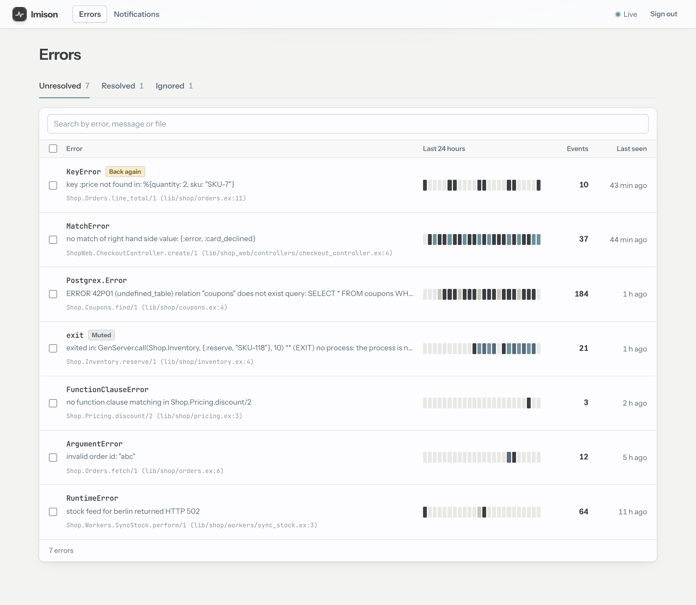
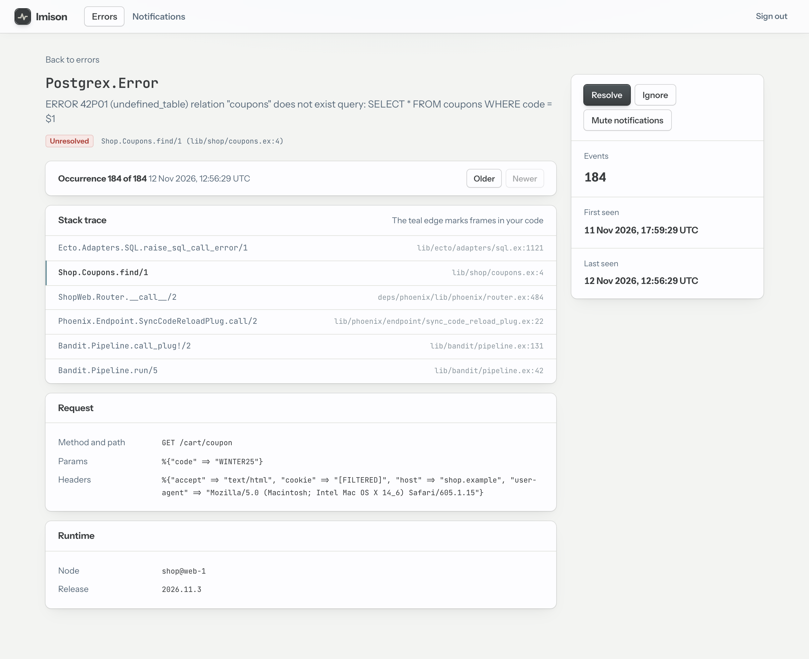

# Imison

**An error tracker that runs inside your Phoenix app.**

Imison captures your app's errors, groups them, stores them in your app's own
Postgres database and shows them on a dashboard mounted in your router. When
something new breaks, it tells you by email, Slack or webhook. You don't need
a separate service, an account or an API key: you add it like Oban, with one
dependency, one install task and one migration.



## Why Imison

Hosted error trackers are good, but for many Phoenix apps they're more than
the job needs:

- **Another service.** You get another account, API key, bill and vendor to
  approve.
- **Data leaves your infrastructure.** Errors carry request params, headers
  and stack traces, and that data goes to a third party.
- **Per-event pricing.** A crash storm can cost you, or get dropped by rate
  limits, just when you need the data.

Imison takes the other route. Everything an error tracker needs is already in
a Phoenix app: a database, a PubSub, a mailer, a router and LiveView. Imison
reuses them:

- **No extra deployment.** It starts and stops with your app, in your
  supervision tree.
- **Your data stays yours.** Errors live in `imison_*` tables in your
  database, are backed up with it, and can be queried with SQL.
- **No credentials to manage** beyond a dashboard password.
- **It never slows your app down.** Capture is asynchronous and bounded.
  Imison's own failures are logged, never raised into your code.

The trade-off: errors are stored in your app's database, so an outage of that
database can't be recorded. It only reaches your logs.

## What it does

- **Captures without code changes**: Phoenix request exceptions, Oban job
  failures and crashed processes. `Imison.report/3` covers exceptions you
  rescue yourself.
- **Groups occurrences** into errors by exception and the function in your
  code where they happened, not by message.
- **Triages**: Unresolved, Resolved and Ignored tabs, search, and actions on
  several errors at once. A resolved error that happens again comes back
  flagged "Back again".
- **Updates live**: the list follows new errors as they happen, with an
  hourly heat strip for each error.
- **Shows the details**: stack traces with your own frames highlighted, the
  request, the job or process metadata, the node and the release. You can
  step through every occurrence.
- **Notifies**: on a new error, a returning error, an error that keeps
  happening (at most hourly) and a daily summary, by email, Slack or a signed
  webhook. You can [write your own channel](guides/custom-channels.md) in a
  few dozen lines.
- **Stays safe**: secrets are filtered from params, headers and metadata
  before storage. The dashboard has its own login, throttled against
  password guessing.
- **Stays small**: occurrences older than 30 days (configurable) are pruned
  hourly, and errors are kept.
- **Runs on several nodes**: counts, notifications sent "once" and the
  sign-in throttle are coordinated through the database. Clustering is
  optional.



## Quick start

Requirements: Elixir 1.20+, Phoenix with LiveView, Ecto on PostgreSQL.

```elixir
# mix.exs
{:imison, "~> 0.1"},
{:igniter, "~> 0.8", only: [:dev]}
```

```sh
mix deps.get
mix imison.install
mix ecto.migrate
```

`mix imison.install` does four things:

- adds the config and the supervision-tree entry
- generates the migration
- mounts the dashboard at `/errors`
- writes a dev login to `config/dev.exs`

It shows each change and asks before writing it. Without Igniter, it prints
the steps for you to apply by hand.

Start your app, open <http://localhost:4000/errors> and sign in. Every
unhandled exception from now on shows up there.

In production, set the dashboard login in the environment:

```sh
IMISON_USER=ops IMISON_PASSWORD="a long random password"
```

### Report a rescued exception

```elixir
try do
  MyApp.Payments.charge(order)
rescue
  exception ->
    Imison.report(exception, __STACKTRACE__, %{order_id: order.id})
    {:error, :charge_failed}
end
```

### Get notified

Set your mailer and sender:

```elixir
config :my_app, Imison,
  mailer: MyApp.Mailer,
  from: "errors@example.com",
  dashboard_url: "https://app.example.com/errors"
```

Then, on the dashboard's Notifications screen, enter recipients on the Email
panel, switch it on and save. To post to Slack or a webhook too, list them in
`channels`, together with Email, since the list replaces the default:

```elixir
config :my_app, Imison,
  channels: [
    Imison.Notifications.Channels.Email,
    Imison.Notifications.Channels.Slack,
    Imison.Notifications.Channels.Webhook
  ]
```

## Documentation

| Guide | What's in it |
|---|---|
| [Getting started](guides/getting-started.md) | Installing, the first error, installing by hand |
| [Using the dashboard](guides/dashboard.md) | Signing in, the error list, statuses, search, the detail page, muting |
| [Capturing errors](guides/capturing-errors.md) | What is captured, grouping, `Imison.report/3`, `filter`, `ignore`, `release` |
| [Notifications](guides/notifications.md) | Rules, email, Slack, webhooks and signature checks, delivery records |
| [Writing a notification channel](guides/custom-channels.md) | The channel behaviour, a complete PagerDuty example, testing it |
| [Configuration](guides/configuration.md) | Every option, the route, migrations, retention, several nodes, production checklist |

The API reference is in the module docs: `Imison`, `Imison.Config`,
`Imison.Migration`, `Imison.Web.Router`, `Imison.Notifications.Channel` and
`Imison.Notifications.Message`. Build everything as HTML with `mix docs`.

## Status

Version 0.1. Every feature above is built and tested, but the API may change
before 1.0. Schema changes ship as new `Imison.Migration` versions, the way
Oban's do.

## Development

```sh
mix deps.get
mix check          # compile with warnings as errors, unused deps, format, Credo, tests
mix test           # tests only; needs Postgres at postgres:postgres@localhost:5432
mix docs           # HTML docs in doc/
```

Some details about the tests:

- **Database**: `mix test` creates and migrates `imison_test`; it never drops
  it. After editing an unreleased migration version, run
  `MIX_ENV=test mix ecto.drop` and then `mix test`.
- **`epmd`**: the cluster test starts a `:peer` node, so `epmd` must be able
  to run.

To try Imison in a real host, keep a small Phoenix app in `dev/` with a path
dependency (`{:imison, path: ".."}`). `dev/` is gitignored, so each
maintainer keeps their own.

For contributors:

- [`CONTEXT.md`](https://github.com/elpikel/imison/blob/main/CONTEXT.md): the domain language
- [`ARCHITECTURE.md`](https://github.com/elpikel/imison/blob/main/ARCHITECTURE.md): what is built and where code goes
- [`docs/PROJECT.md`](https://github.com/elpikel/imison/blob/main/docs/PROJECT.md): the design
- [`docs/STORIES.md`](https://github.com/elpikel/imison/blob/main/docs/STORIES.md): the backlog
- [`docs/adr/`](https://github.com/elpikel/imison/tree/main/docs/adr/): decisions
- [`docs/MEMORY.md`](https://github.com/elpikel/imison/blob/main/docs/MEMORY.md): the decision log
- [`docs/design/`](https://github.com/elpikel/imison/tree/main/docs/design/): dashboard mockups
