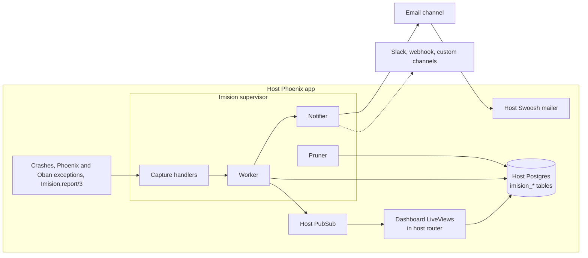

# Imision: architecture and user stories

11 Nov 2026 · Arkadiusz Plichta

Imision is a library you add to a Phoenix app, installed the way Oban is: one dependency, one install task, one migration. It runs inside the host app, stores errors in the app's own Postgres database and serves its dashboard from the app's router.

This is the design. `ARCHITECTURE.md` describes what is built so far; decisions are recorded in `docs/adr/`; the language is in `CONTEXT.md`.

## At a glance

Imision catches errors inside the app, writes them to the app's database, pushes changes to the open dashboard and hands new or returning errors to the notifier. The dashed box is the extension point for further channels.



## Stack

There is no separate service to host. Imision reuses what the host app already has: its repo, its PubSub, its mailer and its router.

| Component | Choice | Why |
|---|---|---|
| Packaging | Hex package `imision`, a dependency of the host app | Nothing extra to deploy, back up or secure |
| Installer | Igniter task `mix imision.install` | Writes the config, supervision-tree entry, migration and route in one step, as `mix oban.install` does |
| Runtime | `Imision` supervisor in the host's supervision tree | Started and stopped with the app; isolated from the app's own processes |
| Storage | The host's Ecto repo on Postgres, tables prefixed `imision_` | Errors are backed up with the app's data; versioned migrations through `Imision.Migration` |
| Capture | `:logger` handler plus telemetry handlers for Phoenix and Oban | Catches crashes without code changes in the host app |
| Dashboard | LiveViews mounted by the `imision_dashboard` router macro, CSS and JS bundled in the package | No changes to the host's asset pipeline, as with Oban Web |
| Live updates | The host's `Phoenix.PubSub` | Dashboard updates across nodes |
| Email | The host's Swoosh mailer | No second set of mail credentials |
| Auth | Built-in session login checked against config | Works in production without depending on the host's user system |
| Background work | `Task.Supervisor` and a pruner process inside the Imision supervisor | No hard dependency on Oban |

## Package structure

Imision is a plain Mix library published on Hex, created with `mix new imision`, not a Phoenix app. It has no endpoint, router or repo of its own and starts nothing by itself: the host app supplies all three and adds `{Imision, opts}` to its own supervisor.

```
lib/imision.ex                    supervisor, config validation, report/3
lib/imision/migration.ex          versioned up/down
lib/imision/capture/              logger handler, telemetry handlers, worker
lib/imision/errors/               schemas, fingerprint, upsert, pruner
lib/imision/notifications/        notifier, Channel behaviour, Email channel
lib/imision/web/router.ex         imision_dashboard macro
lib/imision/web/live/             error list, error detail, notifications, login
lib/mix/tasks/imision.install.ex  Igniter installer
priv/static/                      prebuilt app.css and app.js
dev/                              small Phoenix host app for development, not published
```

| Dependency | Kind | Used for |
|---|---|---|
| `phoenix_live_view` | Required | Dashboard LiveViews and the router macro |
| `ecto_sql`, `postgrex` | Required | Schemas, queries and migrations through the host repo |
| `jason`, `telemetry` | Required | Encoding stack traces and context; attaching to Phoenix and Oban events |
| `swoosh` | Optional | The email channel compiles only when the host has it |
| `oban` | Optional | The job-failure hook attaches only when the host has it |
| `igniter` | Optional | `mix imision.install`; without it the task prints the manual steps |

The CSS and JS are built once and committed under `priv/static`, then served by Imision's own routes, so the host's asset pipeline is never involved.

The stylesheet is [`priv/static/app.css`](../priv/static/app.css): plain CSS, no build step. Its fonts, Instrument Sans and JetBrains Mono, are bundled in `priv/static/fonts/` (WOFF2, latin and latin-ext) with their SIL OFL 1.1 licenses, so the dashboard makes no requests to a font CDN. The visual design is in [`docs/design/`](design/), as static mockups of each screen that link to that stylesheet: `login.html`, `errors.html`, `error-detail.html`, `notifications.html`, and `preview.html` with all screens in one page. The LiveViews reuse the mockups' markup and class names. During development the app under `dev/` starts an endpoint, a repo and Imision, and raises sample errors to fill the dashboard.

It ships as one package. Oban splits its core from its dashboard (`oban` and `oban_web`); Imision would split the same way only if an app without Phoenix needs capture alone.

## Installation

Installation copies Oban's: an Igniter-powered task does every step, and each step can also be done by hand. Oban's installer writes its config, adds Oban to the supervision tree and generates a migration that calls `Oban.Migration.up()`; Oban Web's adds a router import and an `oban_dashboard "/oban"` route.

```elixir
# mix.exs
{:imision, "~> 0.1"},
{:igniter, "~> 0.5", only: [:dev]}
```

```sh
mix deps.get
mix imision.install      # or in one step: mix igniter.install imision
mix ecto.migrate
```

`mix imision.install` makes these five changes, and skips any that are already there:

```elixir
# 1. config/config.exs
config :my_app, Imision,
  repo: MyApp.Repo,
  pubsub: MyApp.PubSub,
  mailer: MyApp.Mailer

# 2. config/runtime.exs
config :my_app, Imision,
  username: System.fetch_env!("IMISION_USER"),
  password: System.fetch_env!("IMISION_PASSWORD")

# 3. lib/my_app/application.ex, after the repo
{Imision, Application.fetch_env!(:my_app, Imision)}

# 4. priv/repo/migrations/20261111120000_add_imision.exs
def up, do: Imision.Migration.up(version: 1)
def down, do: Imision.Migration.down(version: 1)

# 5. lib/my_app_web/router.ex
import Imision.Router

scope "/" do
  pipe_through :browser
  imision_dashboard "/errors"
end
```

It also sets `config :my_app, Imision, enabled: false` in `config/test.exs`. Unlike Oban Web, which mounts its dashboard inside the dev-only routes, Imision mounts the route for every environment, because it brings its own login.

## Data model

An error is a group; an occurrence is one event in that group. There are no projects or environments: each deployment of the host app has its own database and so its own dashboard.

| Table | Holds | Key fields |
|---|---|---|
| `imision_errors` | One group of matching occurrences | `fingerprint` (unique), `kind`, `message`, `location`, `status` (`unresolved`, `resolved`, `ignored`), `muted`, `first_seen_at`, `last_seen_at`, `occurrence_count` |
| `imision_occurrences` | One event | `error_id`, `stacktrace` (jsonb), `context` (jsonb: request, metadata, runtime), `release`, `occurred_at` |
| `imision_hourly_counts` | Events per error per hour, for the heat strips | `error_id`, `hour`, `count` |
| `imision_channels` | One configured notification channel | `type` (email first), `enabled`, `config` (jsonb) |
| `imision_rules` | When to notify | `trigger` (`new`, `regression`, `still_happening`, `digest`), `enabled` |
| `imision_deliveries` | Sent notifications, for throttling and debugging | `channel_id`, `error_id`, `trigger`, `status`, `sent_at` |

`Imision.Migration` is versioned the way `Oban.Migration` is: a release that changes the schema ships version 2, and the host adds a migration that calls `Imision.Migration.up(version: 2)`. The unique index on `fingerprint` makes capture an upsert. A pruner process deletes occurrences older than `retention_days` and keeps the error row.

## How an error flows

1. When the Imision supervisor starts, it attaches a `:logger` handler and telemetry handlers for Phoenix request exceptions and Oban job exceptions. `Imision.report/3` covers errors the app rescues itself.
2. A handler runs in the process that crashed or logged, so it only builds the event (kind, message, stack trace, metadata, release) and casts it to an Imision worker. When the worker's queue is full the event is dropped and counted, so a crash storm cannot slow the app.
3. The worker computes a fingerprint: a hash of the exception module plus the first application frame (module, function, arity). Messages are left out so that values such as ids do not split groups.
4. One transaction through the host repo upserts the error, inserts the occurrence and increments the hourly count. A resolved error that receives a new occurrence flips back to unresolved and is flagged as a regression.
5. The worker broadcasts on the host PubSub; open dashboard LiveViews update the list and counts in place.
6. The notifier evaluates the rules for that event (new, regression, still happening), checks `imision_deliveries` for throttling and hands the message to each enabled channel.

Errors raised inside Imision itself are only logged, never captured, so it cannot report on itself in a loop.

## Running on multiple nodes

Every node runs its own Imision supervisor and all of them write to the same Postgres, so the database, not the cluster, decides who acts. That keeps Imision correct whether or not the nodes are connected by distributed Erlang.

| Concern | Risk with several nodes | How Imision handles it |
|---|---|---|
| Grouping and counts | Two nodes record the same error at once | One `INSERT ... ON CONFLICT DO UPDATE` on the unique fingerprint; the hourly count is incremented the same way |
| Where it happened | The list hides which node failed | Each occurrence stores the node name, shown under Runtime |
| Dashboard and login | The load balancer picks a different node per request | Every node reads the same tables; the session cookie is signed with the shared `secret_key_base` |
| Live updates | Without clustering, a broadcast stays on the node that caught the error | Host PubSub when the nodes are clustered; otherwise the dashboard refreshes from the database every few seconds |
| "New error" notification | Each node that sees the error sends one | Only the node whose upsert inserted the row sends |
| "Came back" notification | Each node that sees the regression sends one | Only the node whose `UPDATE ... WHERE status = 'resolved'` changed the row sends |
| Throttled reminders and the daily digest | Every node's timer fires | A node first inserts a row in `imision_deliveries` under a unique index on (error, trigger, period) and sends only if the insert succeeded |
| Pruning | Every node deletes old occurrences | Safe to repeat; the deletes are idempotent |
| Failed-login slowdown | Attempts are spread over nodes | Counted in the database, not in node memory |
| Rolling deploys | Old and new code run side by side | Migration versions only add tables, columns and indexes |

## Notification channels

Each channel is a module that implements one behaviour, so adding Slack or a webhook later means one new module and one line in the registry. Rules and throttling live in the notifier, not in the channels.

```elixir
defmodule Imision.Notifications.Channel do
  @callback type() :: String.t()
  @callback validate_config(map()) :: :ok | {:error, keyword()}
  @callback deliver(Imision.Notifications.Message.t(), config :: map()) ::
              :ok | {:error, term()}
end

# config/config.exs, optional: the default list holds only Email
config :my_app, Imision,
  channels: [Imision.Notifications.Channels.Email, MyApp.SlackChannel]
```

`Message` is channel-neutral: trigger, error kind and message, location, counts and a link back to the error. The email channel renders it and sends it through the host app's Swoosh mailer; recipients and rules come from the Notifications screen. Because the list is plain config, a host app can add its own channel module without a new Imision release.

## Configuration

Options live under the host app's config key, as with Oban. Only the login comes from environment variables, read in `config/runtime.exs`; Imision refuses to start when a required option is missing.

| Option | Required | Purpose |
|---|---|---|
| `repo` | Yes | The host's Ecto repo |
| `username`, `password` | Yes | Dashboard login, set from `IMISION_USER` and `IMISION_PASSWORD`; compared in constant time with `Plug.Crypto.secure_compare/2` |
| `pubsub` | No | The host's PubSub server; without it the dashboard updates only on the node that caught the error |
| `mailer` | For email | The host's Swoosh mailer module |
| `from` | For email | Sender address |
| `release` | No | Version label stored with each occurrence |
| `retention_days` | No | Days to keep occurrences, default 30 |
| `channels` | No | Notification channel modules, default email only |
| `enabled` | No | `false` turns capture off, for the test environment |
| `filter` | No | Keys replaced with `[FILTERED]` in params, headers and metadata before storage; defaults to `password`, `token`, `secret`, `authorization` and `cookie` |
| `ignore` | No | Exception modules that are never recorded, default none |

## User stories

The stories, with IDs, build order, dependencies and what "done" means for each, are the backlog in [`STORIES.md`](STORIES.md). Phase 1 is the smallest version worth installing; phase 2 makes it comfortable; phase 3 is the extension work.

## Open decisions

- [ ] Errors are stored in the app's own database, so a database outage cannot be recorded; it only reaches the log. Is that acceptable, or should Imision support a separate repo?
- [ ] Built-in login only (assumed), or also an option to put the dashboard behind the host app's existing admin authentication? (ADR 0004, proposed)
- [ ] Is requiring Phoenix LiveView in the host app acceptable? An app without it could still capture errors but would have no dashboard.
- [ ] Deliver notifications with Imision's own `Task.Supervisor` (assumed), or through the host's Oban when it is present, for retries? (ADR 0005, proposed)
- [ ] Is one login enough, or will a read-only second login be wanted soon?
