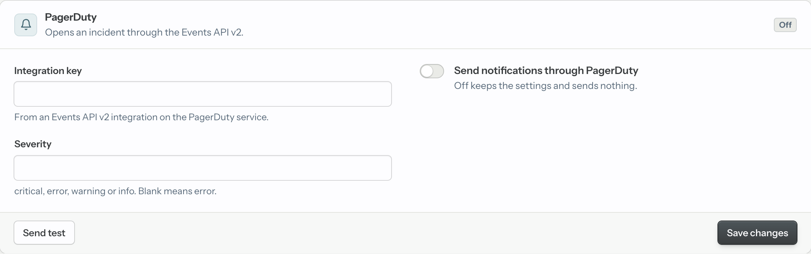

# Writing a notification channel

Email, Slack and webhook are built in. For anything else, such as PagerDuty,
Microsoft Teams, Discord, SMS or an internal service, write a channel in your
own app. A channel is a module that implements the
`Imison.Notifications.Channel` behaviour. List it in `channels` and Imison
gives it:

- its own panel on the Notifications screen, with settings, an on/off switch,
  Save and Send test
- the stored settings, validated by your module
- every notification the rules allow, sent in the background
- a delivery record and a log entry when it fails

Your module only turns an `Imison.Notifications.Message` into a request to
the service. You don't need a new Imison release.

This guide builds a PagerDuty channel that opens an incident for each error.



## The behaviour

| Callback | Required | What it does |
|---|---|---|
| `type/0` | Yes | A stable string key, e.g. `"pagerduty"`. The settings are stored under it, so don't change it once the channel is in use. |
| `validate_config/1` | Yes | Checks the stored settings: `:ok`, or `{:error, [field: "reason"]}`. |
| `deliver/3` | Yes | Sends one message. Returns `:ok` or `{:error, reason}`. |
| `label/0` | No | The panel's title. Defaults to `type/0`. |
| `config_fields/0` | No | The settings the panel asks for, in order. Defaults to none. |
| `describe/1` | No | A line under the panel's title, given Imison's config. Defaults to none. |

Imison checks that every module in `channels` exports `type/0`,
`validate_config/1` and `deliver/3`. If one doesn't, the app fails to boot
with an `ArgumentError`.

## A complete example: PagerDuty

```elixir
defmodule MyApp.Imison.PagerDuty do
  @moduledoc """
  Opens a PagerDuty incident for each error notification, through the
  Events API v2. Repeats of one error update the same incident.
  """
  @behaviour Imison.Notifications.Channel

  alias Imison.Notifications.Message

  @events_url "https://events.pagerduty.com/v2/enqueue"
  @severities ~w(critical error warning info)

  @impl true
  def type, do: "pagerduty"

  @impl true
  def label, do: "PagerDuty"

  @impl true
  def describe(_imison_config), do: "Opens an incident through the Events API v2."

  @impl true
  def config_fields do
    [
      %{
        name: "routing_key",
        label: "Integration key",
        type: :secret,
        hint: "From an Events API v2 integration on the PagerDuty service."
      },
      %{name: "severity", label: "Severity", type: :text, hint: "critical, error, warning or info. Blank means error."}
    ]
  end

  @impl true
  def validate_config(%{"routing_key" => _key} = config) do
    if Map.get(config, "severity", "error") in @severities,
      do: :ok,
      else: {:error, severity: "must be one of #{Enum.join(@severities, ", ")}"}
  end

  def validate_config(_config), do: {:error, routing_key: "can't be blank"}

  @impl true
  def deliver(%Message{trigger: :digest}, _config, _imison_config), do: :ok

  def deliver(%Message{} = message, config, _imison_config) do
    event = %{
      routing_key: config["routing_key"],
      event_action: "trigger",
      dedup_key: dedup_key(message),
      payload: %{
        summary: summary(message),
        source: message.location || "imison",
        severity: Map.get(config, "severity", "error")
      },
      links: links(message)
    }

    req_options = [json: event, retry: false, receive_timeout: 5_000]

    case Req.post(@events_url, req_options ++ Application.get_env(:my_app, :pagerduty_req_options, [])) do
      {:ok, %Req.Response{status: status}} when status in 200..299 -> :ok
      {:ok, %Req.Response{status: status}} -> {:error, {:http_status, status}}
      {:error, exception} -> {:error, Exception.message(exception)}
    end
  end

  defp dedup_key(%Message{trigger: :test}), do: "imison-test"
  defp dedup_key(%Message{error_id: error_id}), do: "imison-error-#{error_id}"

  defp summary(%Message{trigger: :test}), do: "Test from Imison: PagerDuty delivery works"

  defp summary(%Message{} = message) do
    headline =
      case message.trigger do
        :new -> "New error"
        :regression -> "Came back"
        :still_happening -> "Still happening"
      end

    String.slice("#{headline}: #{message.kind}: #{message.message}", 0, 1024)
  end

  defp links(%Message{url: nil}), do: []
  defp links(%Message{url: url}), do: [%{href: url, text: "Open in Imison"}]
end
```

Register it next to the built-in channels:

```elixir
config :my_app, Imison,
  channels: [
    Imison.Notifications.Channels.Email,
    MyApp.Imison.PagerDuty
  ]
```

Restart the app, open the Notifications screen, paste the integration key,
switch the channel on and save. "Send test" sends a `:test` message through
it straight away.

The example uses [Req](https://hexdocs.pm/req), which new Phoenix apps
already depend on. Any HTTP client works. Check the request fields against
[PagerDuty's Events API v2 documentation](https://developer.pagerduty.com/docs/events-api-v2/trigger-events/)
before you rely on them.

## Settings: `config_fields/0`

Each field is a map with `name`, `label`, `type` and an optional `hint`:

| `type` | Input | Stored as |
|---|---|---|
| `:recipients` | A textarea; values separated by commas or new lines | A list of strings, without blanks or repeats |
| `:text` | A text input | A trimmed string; removed when blank |
| `:url` | A URL input | Like `:text` |
| `:secret` | A password input | Like `:text`, but never shown back |

Use `:secret` for anything that grants access: API keys, tokens, and webhook
URLs that carry a token, as Slack's do.

- **On the panel:** a stored secret shows as "Set — leave blank to keep", and
  a "Remove" box clears it.
- **In your module:** never put a secret into an error reason or a log. Imison
  logs the `{:error, reason}` your `deliver/3` returns.

The values reach your callbacks as one map with **string keys**, the field
names:

```elixir
%{"routing_key" => "R0123456789ABCDEF", "severity" => "critical"}
```

They are stored in `imison_channels.config` (jsonb) in the row for your
`type/0`. Keys in the stored row that your fields don't list are kept when
the panel is saved, so you can rename a field without losing the old value.

## Validation: `validate_config/1`

Imison calls `validate_config/1` when the panel is saved, and on "Send test"
with the panel's values. Return `{:error, keyword}` to refuse the save or
the test:

- A reason keyed by a field's name is shown under that field.
- Any other reason is shown under the panel's fields.
- Nothing is stored.

Imison calls it again before every delivery, with the stored settings. A
channel whose settings stopped passing (say, after you tightened the rules in
a new version) is skipped until someone fixes them on the screen.

Validate what you can without network calls. "Send test" is how the
developer checks that the settings actually work.

## Sending: `deliver/3`

```elixir
@callback deliver(Message.t(), channel_config :: map(), Imison.Config.t()) :: :ok | {:error, term()}
```

- **Arguments:** the message, your stored settings, and Imison's config. The
  config holds `dashboard_url`, `mailer`, `from` and `release`, if your
  channel needs them.
- **Return value:** `:ok` when the service accepted the message. Otherwise
  `{:error, reason}`: the delivery is recorded as `failed` and the reason is
  logged under the `:imison` logger domain. A raised exception is treated the
  same way, so a bug in your channel can't crash Imison or your app.
- **Where it runs:** never in the process that crashed, so it may block on
  the network.
  - Messages about an error run in a task under Imison's own supervisor.
  - The daily summary runs in Imison's summary process, one channel after
    another.
  - "Send test" runs in the dashboard's LiveView and waits for the result to
    show it on the screen.

  Always set timeouts: a hanging service piles up tasks, holds up the summary
  for every channel after yours and freezes the screen on "Send test".
- **Retries:** none. Each message is attempted once.

### The message

`Imison.Notifications.Message` is the same for every channel:

| Field | Type | Notes |
|---|---|---|
| `trigger` | `:new`, `:regression`, `:still_happening`, `:digest` or `:test` | What the message is about |
| `error_id` | integer or `nil` | |
| `kind` | string or `nil` | The exception module, or `exit` or `throw` |
| `message` | string or `nil` | The full message; may span several lines and be long |
| `location` | string or `nil` | `Module.function/arity (file:line)`; `nil` with an empty stack trace |
| `occurrence_count` | integer or `nil` | |
| `first_seen_at`, `last_seen_at` | `DateTime` or `nil` | UTC |
| `regressed_at` | `DateTime` or `nil` | When the error last came back |
| `url` | string or `nil` | The error's page; `nil` without `dashboard_url` |
| `summary` | map or `nil` | Only for `:digest` |

**The error fields are `nil` for `:digest` and `:test`.** Those messages are
about no single error, so match them before any code that reads `kind` or
`message`. Otherwise your channel raises on the first daily summary or the
first test.

### The daily summary

When the "Daily summary" rule is on, every channel gets a `:digest` message
once a day. Either render it or skip it by returning `:ok`, as the PagerDuty
example does: an incident tool has no use for a summary.

To render it, read `summary`:

```elixir
%{
  date: ~D[2026-11-11],
  url: "https://app.example.com/errors",
  new: %{lines: [...], total: 3},
  came_back: %{lines: [...], total: 1},
  most_frequent: %{lines: [...], total: 9}
}
```

- **Lines**: each line is a map with `error_id`, `kind`, `message`,
  `location`, `count` (that day's occurrences) and `url`.
- **Caps**: `lines` holds at most 20 errors (5 for `most_frequent`), while
  `total` counts all of them. Say "and N more" when `total` is bigger than
  `length(lines)`.
- **Muted errors** are included.

### Writing for a chat service

Error messages come from your app's exceptions, so treat them as untrusted
text:

- **Cut them short.** A message can be thousands of characters; Ecto and
  Postgrex messages span several lines. The Slack channel keeps the first
  line, at most 300 characters.
- **Escape the service's markup.** An error message containing `<!channel>`
  or `@everyone` shouldn't ping a whole team. The Slack channel escapes `&`,
  `<` and `>`.
- **Keep the link.** Put `url` near the top, so it doesn't get cut off.

## Testing your channel

Test the callbacks directly. Build messages with the struct:

```elixir
test "a new error opens an incident linked to the error" do
  Req.Test.stub(MyApp.Imison.PagerDuty, fn conn ->
    {:ok, body, conn} = Plug.Conn.read_body(conn)
    send(self(), {:pagerduty, JSON.decode!(body)})
    conn |> Plug.Conn.put_status(202) |> Req.Test.json(%{status: "success"})
  end)

  message = %Imison.Notifications.Message{
    trigger: :new,
    error_id: 42,
    kind: "ArgumentError",
    message: "invalid order id",
    location: "MyApp.Orders.fetch/1 (lib/my_app/orders.ex:12)",
    occurrence_count: 1,
    first_seen_at: ~U[2026-11-12 09:30:00Z],
    last_seen_at: ~U[2026-11-12 09:30:00Z],
    url: "https://app.example.com/errors/errors/42"
  }

  conf = Imison.Config.new(repo: MyApp.Repo, username: "test", password: "test")
  assert :ok = MyApp.Imison.PagerDuty.deliver(message, %{"routing_key" => "key"}, conf)

  assert_received {:pagerduty, %{"dedup_key" => "imison-error-42", "links" => [%{"href" => "https://app.example.com/errors/errors/42"}]}}
end

test "the daily summary is skipped" do
  message = %Imison.Notifications.Message{
    trigger: :digest,
    error_id: nil,
    kind: nil,
    message: nil,
    occurrence_count: nil,
    first_seen_at: nil,
    last_seen_at: nil
  }

  conf = Imison.Config.new(repo: MyApp.Repo, username: "test", password: "test")
  assert :ok = MyApp.Imison.PagerDuty.deliver(message, %{"routing_key" => "key"}, conf)
end
```

`Imison.Config.new/1` builds the config your channel receives, validated as
at boot. Pass the options your channel reads, such as `dashboard_url`.

The example's `deliver/3` adds the Req options in `:pagerduty_req_options`
from your app's config, so the tests can send the request to `Req.Test`
instead of PagerDuty:

```elixir
# config/test.exs
config :my_app, :pagerduty_req_options, plug: {Req.Test, MyApp.Imison.PagerDuty}
```

Then click "Send test" on the dashboard against the real service before you
rely on the channel.

## Checklist

- [ ] `type/0` is a stable, unique string.
- [ ] `deliver/3` handles `:digest` and `:test`, whose error fields are `nil`.
- [ ] Credentials are `:secret` fields and never appear in error reasons.
- [ ] Requests have a timeout.
- [ ] Untrusted error text is cut and escaped for the service's markup.
- [ ] A non-success answer returns `{:error, reason}`, so it is recorded and
      logged.
