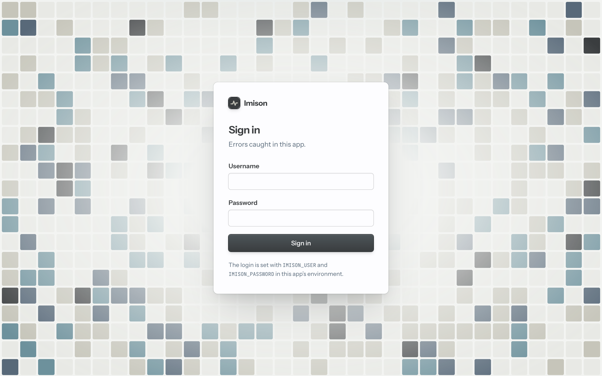
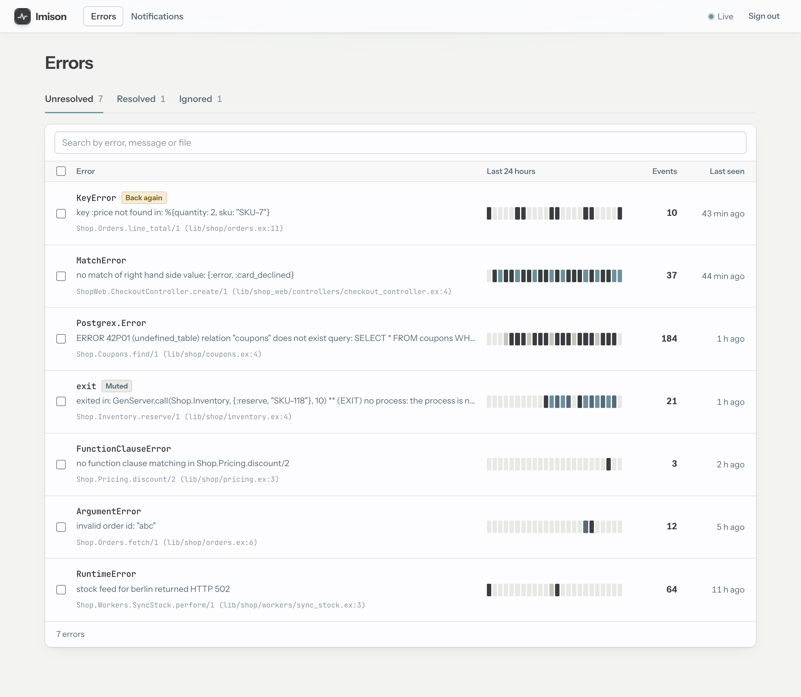
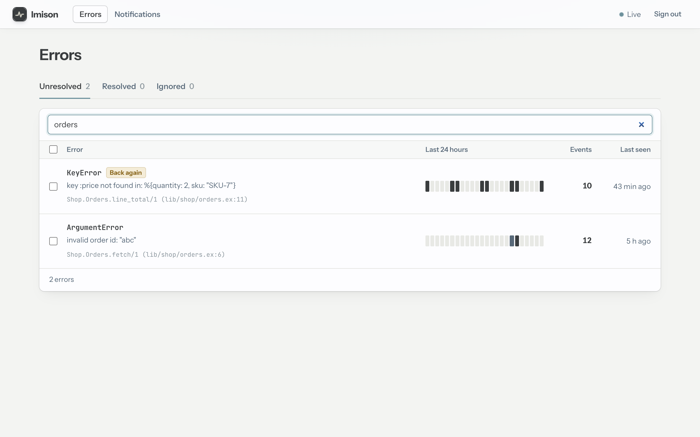
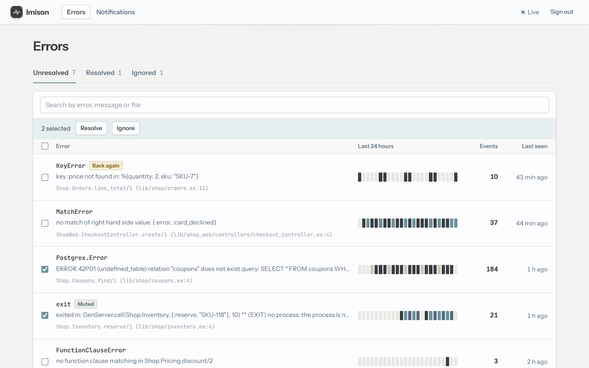
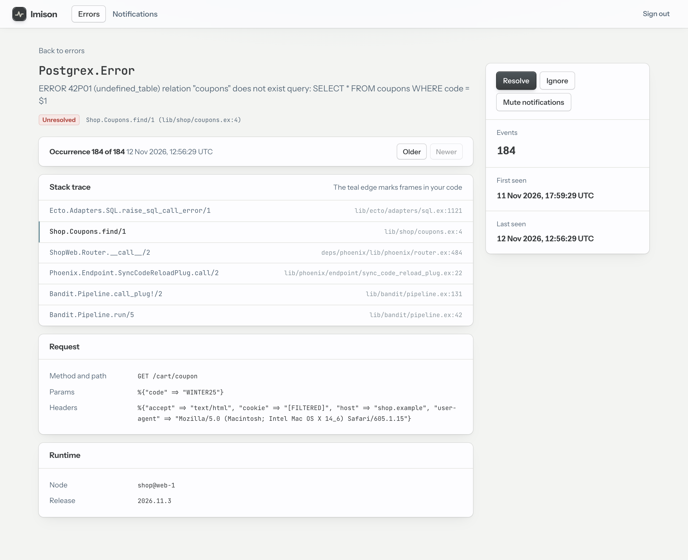
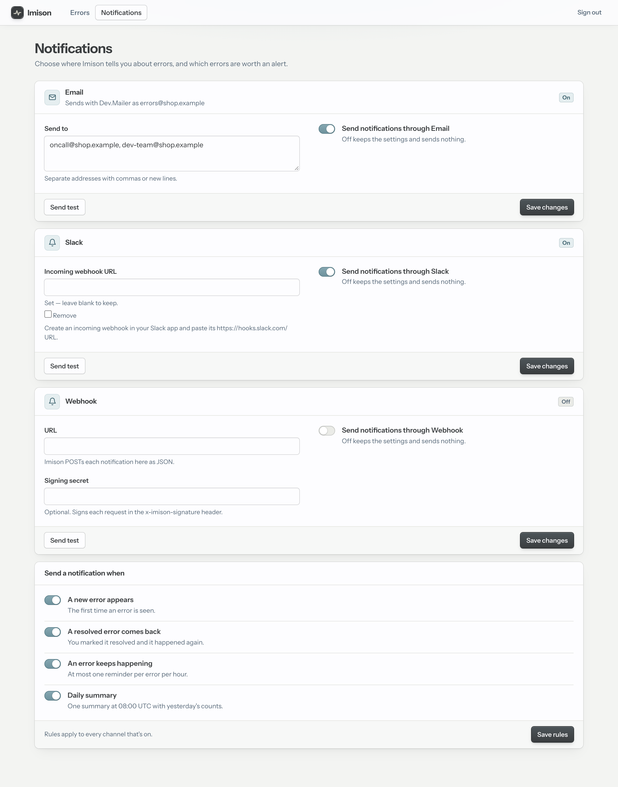

# Using the dashboard

The dashboard is mounted wherever you call `imison_dashboard` in your router
(`/errors` after `mix imison.install`). It has three screens:

- the error list
- an error's detail page
- Notifications

Each one asks for the login set by the `username` and `password` options.

## Signing in

Every dashboard page except the login page (`<path>/login`) requires
signing in. A correct username and password take you to the error list.
Signing in stores a value derived from the credentials, keyed with the
endpoint's `secret_key_base`, in your app's session cookie. The credentials
themselves are never stored, in the cookie or in the database.

- **Signing out:** "Sign out" in the top bar ends that browser's session.
- **Ending every session:** change the password and restart the app. It's the
  only way, because a copy of the cookie stays valid as long as the username,
  password and `secret_key_base` stay the same.
- **Several nodes:** you stay signed in on every node that shares
  `secret_key_base`.

Failed sign-ins are slowed down so the password can't be guessed by brute
force:

- The first five failures within 15 minutes are free.
- After that, each attempt must wait 1, 2, 4, … seconds after the latest
  failure, at most 5 minutes.
- An attempt during the wait gets "Too many failed sign-ins. Try again in N
  seconds." and isn't checked, so even the right password is refused until the
  wait is over.
- The count is shared by every node, because it is stored in the database.
- If the database can't be reached, sign-in is refused with "Sign-in is
  unavailable. Try again shortly."

## The error list

An **error** is a group of occurrences with the same fingerprint: the
exception module plus the function (module, name and arity) of the first
frame from your own code. The message is not part of the fingerprint, so
`invalid order id: "abc"` and `invalid order id: "xyz"` are one error, and
the list shows the latest message.

Each row shows:

| Part | What it is |
|---|---|
| Kind | The exception module, or `exit` or `throw` |
| Message | The latest occurrence's message, cut to one line |
| Location | The first frame from your code, as `Module.function/arity (file:line)` |
| Last 24 hours | The heat strip: one bar per hour, darker for more occurrences |
| Events | The number of occurrences, all time |
| Last seen | When the latest occurrence happened |

Two flags can appear next to the kind:

- **Back again**: the error was resolved and has happened since. This is a
  *regression*.
- **Muted**: the error doesn't send notifications. See
  [Muting](#muting-an-error).

The list shows the 100 most recently seen errors of one status. The footer
says how many there are in all.

### Statuses

The tabs switch between the three statuses and show each one's count:

- **Unresolved**: new errors and errors that came back. This is your inbox.
- **Resolved**: errors you marked as fixed. If one happens again, it moves
  back to Unresolved with the **Back again** flag, and a "came back"
  notification is sent.
- **Ignored**: errors you don't want to see. They keep counting
  occurrences, but they stay in Ignored and never notify.

### Searching

The search box filters the current tab by text in the kind, message or
location:

- It is case-insensitive.
- It is literal: `%` and `_` are plain characters.
- The tab counts follow the search.

The tab and the search are kept in the URL (`/errors?status=resolved&q=timeout`),
so you can bookmark or share a filtered list.

### Acting on several errors

Tick rows, or the box in the header to select all of them, and a bar
appears with the actions that move them out of the current tab: Resolve and
Ignore on Unresolved, Mark unresolved and Ignore on Resolved, and Mark
unresolved and Resolve on Ignored. Other open lists follow the change.

### Live updates

The list updates without a reload: new errors appear, and counts, heat
strips and tab counts change, while your selection and search stay put. The
**Live** indicator in the top bar shows how it updates. Hover over it to see
which mode it is in:

- **With `pubsub` set**, each recorded occurrence is broadcast and the list
  reloads at most once a second, however many errors arrive.
- **Without `pubsub`**, or while the node has no connected nodes, the list
  refreshes from the database every 5 seconds.

Clustering is never required: every node writes to the same database.

## An error's detail page

Click an error's kind to open its detail page. It shows:

- **The header**: the kind, the full message, the status and the location.
- **Actions**: Resolve, Ignore or Mark unresolved, and "Mute notifications"
  (or "Unmute").
- **The counts**: the number of occurrences and when the error was first and
  last seen (UTC).
- **The occurrence**: the latest one, at first. Older and Newer step through
  the rest, one at a time.
- **The stack trace**: frames from your own code have a teal edge. A frame is
  yours when its module belongs to the OTP application of the repo Imison is
  configured with.
- **Request**: for errors raised in a Phoenix request, the method, path,
  params and headers.
- **Logger metadata**: what you passed to `Imison.report/3`, the Oban job
  (worker, queue, args and attempt), or the crashed process.
- **Runtime**: the node that recorded the occurrence and the `release`.

Params, headers and metadata are filtered before they are stored. A key
containing `password`, `token`, `secret`, `authorization` or `cookie` has
its value replaced with `[FILTERED]`. See [the `filter` option](configuration.md#options).

Occurrences older than `retention_days` (30 by default) are deleted every
hour. The error itself is kept, so an old error's detail page still shows its
counts and dates, but no stack trace.

### Muting an error

"Mute notifications" stops the notifications about one error (new, came back
and still happening) while it stays listed and counted under its status. The
daily summary still lists it, because a summary isn't an alert. Unmuting
restores its notifications from its next occurrence.

Use muting for an error you know about and can't fix yet. Use Ignore for an
error you never want to see again.

## Notifications

The Notifications screen (`<path>/notifications`, linked from the top bar)
sets where alerts go and when. It has its own guide:
[Notifications](notifications.md).

