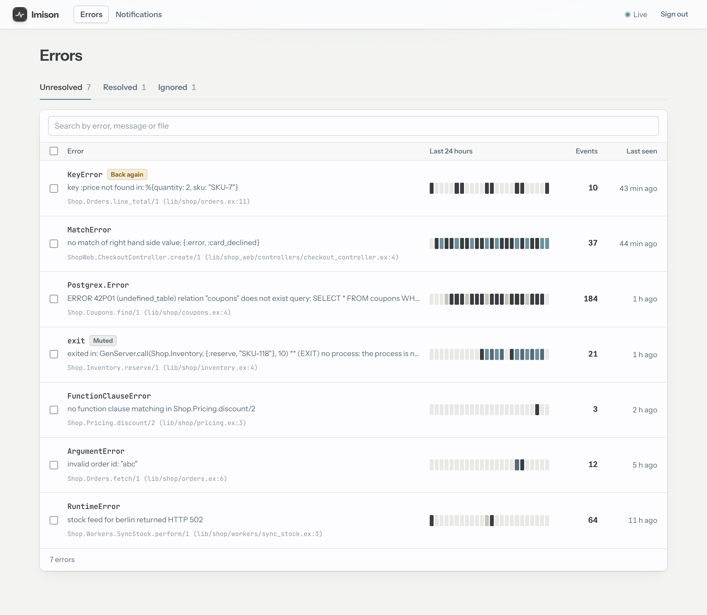
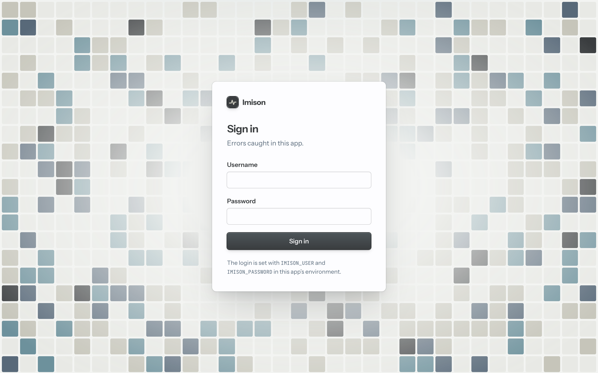

# Getting started

Imison is an error tracker that runs inside your Phoenix app. It captures the
app's errors, groups them, stores them in the app's own Postgres database and
serves a dashboard from the app's router. You don't need a separate service,
an account or an API key.

This guide takes a Phoenix app from nothing to its first tracked error in
about five minutes.



## Requirements

- Elixir 1.20 or later
- A Phoenix app with LiveView (the `mix phx.new` default), an Ecto repo on
  PostgreSQL and a `Phoenix.PubSub`
- Optional: Swoosh, for email notifications (`mix phx.new` includes it)
- Optional: Igniter, so the install task can edit your files for you

## 1. Add the dependency

```elixir
# mix.exs
def deps do
  [
    {:imison, "~> 0.1"},
    {:igniter, "~> 0.8", only: [:dev]}
  ]
end
```

```sh
mix deps.get
```

## 2. Run the installer

```sh
mix imison.install
```

The task is an Igniter task, like `mix oban.install`. It shows each change and
asks before writing it. It skips any change that is already there, so you can
run it again safely. It makes these changes:

| File | Change |
|---|---|
| `config/config.exs` | `config :my_app, Imison` with `repo`, `pubsub` and, when the app has `MyApp.Mailer`, `mailer` |
| `config/runtime.exs` | In production, the dashboard login from `IMISON_USER` and `IMISON_PASSWORD` |
| `config/dev.exs` | The login `admin` with a random password, generated at install time |
| `config/test.exs` | `enabled: false`, so your tests record nothing |
| `lib/my_app/application.ex` | `{Imison, Application.fetch_env!(:my_app, Imison)}` after the repo and PubSub |
| `priv/repo/migrations/*_add_imison.exs` | A migration calling `Imison.Migration.up(version: 1)` |
| `lib/my_app_web/router.ex` | `import Imison.Web.Router` and `imison_dashboard "/errors"` |
| `.formatter.exs` | `:imison` in `import_deps` |

Without Igniter, `mix imison.install` changes no files. It prints the same
steps with your app's names filled in, for you to apply by hand. They are
listed under [Installing by hand](#installing-by-hand) below.

## 3. Migrate

```sh
mix ecto.migrate
```

This creates Imison's tables, all prefixed `imison_`, in your database.

## 4. Open the dashboard

Start the app with `mix phx.server` and open <http://localhost:4000/errors>.
Sign in as `admin` with the password the installer wrote to
`config/dev.exs`.



## 5. Make an error

Raise anything in a controller:

```elixir
def show(_conn, %{"id" => id}) do
  raise ArgumentError, "invalid order id: #{inspect(id)}"
end
```

Request the page, and the error appears in the list within a second. You
don't need to reload the page. Request it again and the error's count goes up
instead of a second row appearing: occurrences with the same exception and
the same place in your code are grouped into one error.

## Production

In production, set the dashboard login through the environment:

```sh
IMISON_USER=ops IMISON_PASSWORD="a long random password" bin/my_app start
```

If either variable is missing, `System.fetch_env!/1` in `config/runtime.exs`
raises and the app refuses to boot, so you can't deploy an open dashboard by
accident.

Next steps:

- [Using the dashboard](dashboard.md): triage errors, the list and the detail page
- [Capturing errors](capturing-errors.md): what is captured, `Imison.report/3` and filtering
- [Notifications](notifications.md): email, Slack and webhooks
- [Configuration](configuration.md): every option

## Installing by hand

These are the steps `mix imison.install` performs. `:my_app` and `MyApp`
stand for your app's name and module prefix.

1. `config/config.exs`. `pubsub` is your endpoint's `pubsub_server`. Leave out
   `mailer` if the app doesn't send email through a Swoosh mailer.

   ```elixir
   config :my_app, Imison,
     repo: MyApp.Repo,
     pubsub: MyApp.PubSub,
     mailer: MyApp.Mailer
   ```

2. `config/runtime.exs`, inside `if config_env() == :prod do`:

   ```elixir
   config :my_app, Imison,
     username: System.fetch_env!("IMISON_USER"),
     password: System.fetch_env!("IMISON_PASSWORD")
   ```

3. `config/dev.exs`:

   ```elixir
   config :my_app, Imison, username: "admin", password: "<a password you pick>"
   ```

4. `config/test.exs`, so your tests record nothing:

   ```elixir
   config :my_app, Imison, enabled: false, username: "test", password: "test"
   ```

5. `lib/my_app/application.ex`, in the children list after `MyApp.Repo` and
   the `Phoenix.PubSub` child:

   ```elixir
   {Imison, Application.fetch_env!(:my_app, Imison)}
   ```

6. A migration. Generate it with `mix ecto.gen.migration add_imison`, then
   fill it in:

   ```elixir
   defmodule MyApp.Repo.Migrations.AddImison do
     use Ecto.Migration

     def up, do: Imison.Migration.up(version: 1)
     def down, do: Imison.Migration.down(version: 1)
   end
   ```

7. `lib/my_app_web/router.ex`: import the macro after `use MyAppWeb, :router`,
   then mount the dashboard in a scope that pipes through `:browser`:

   ```elixir
   import Imison.Web.Router

   scope "/" do
     pipe_through :browser

     imison_dashboard "/errors"
   end
   ```

8. `.formatter.exs`, so `imison_dashboard` is formatted without parentheses:

   ```elixir
   import_deps: [:imison, ...]
   ```

Then run `mix ecto.migrate`.

The `:browser` pipeline must call `fetch_session` and `protect_from_forgery`,
as the one `mix phx.new` generates does. Your endpoint also needs the LiveView
socket, with the session passed in `connect_info`:

```elixir
socket "/live", Phoenix.LiveView.Socket, websocket: [connect_info: [session: @session_options]]
```
