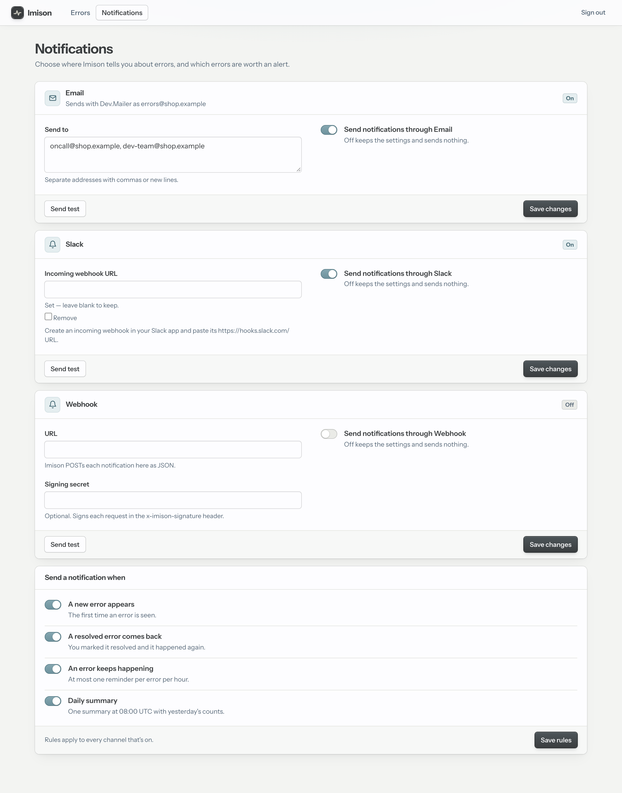
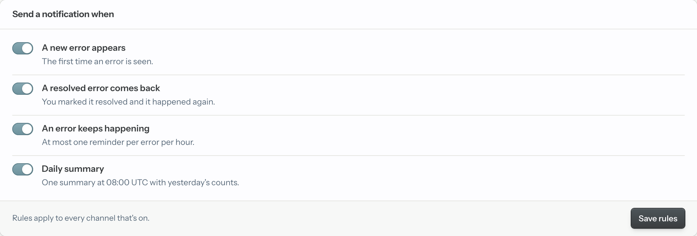
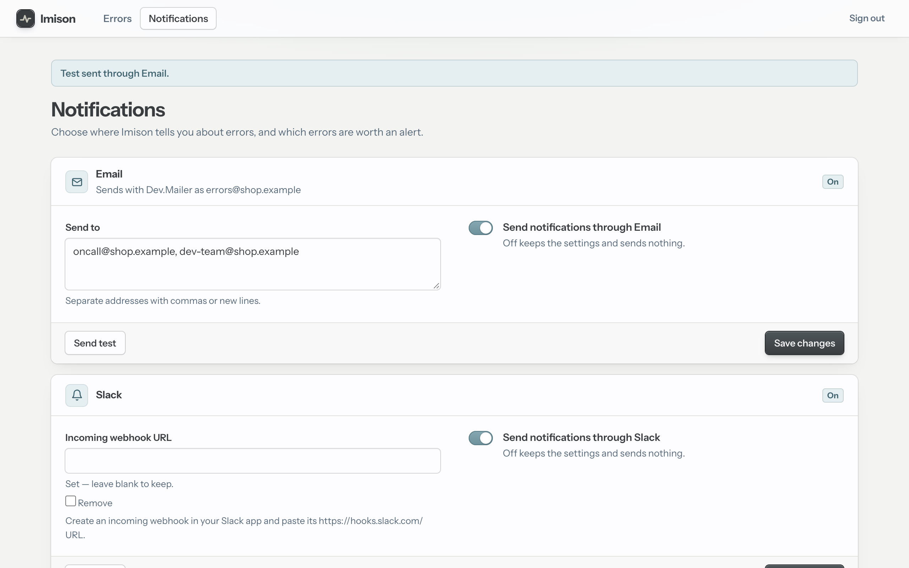
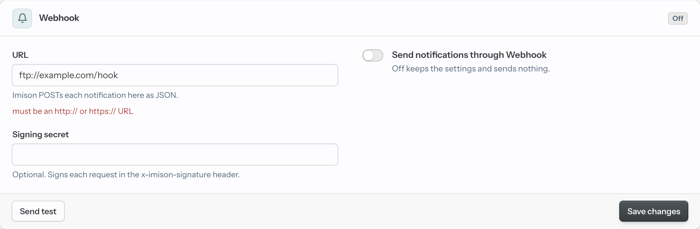
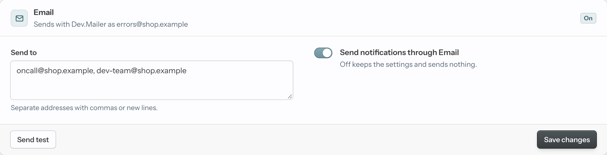
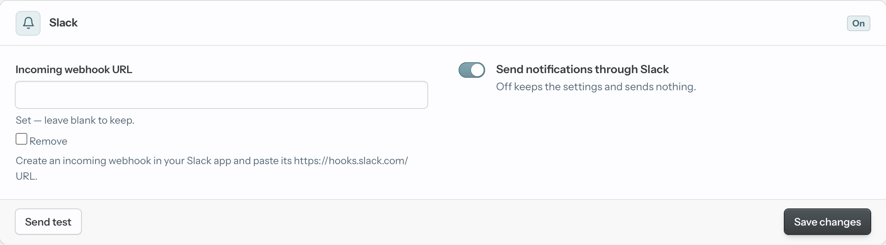
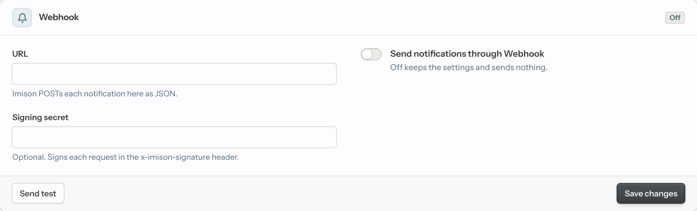

# Notifications

Imison tells you when something goes wrong, so you don't have to keep the
dashboard open. Notifications are made of three parts:

- **Channels**: where messages go. Email, Slack and webhook are built in, and
  you can [write your own](custom-channels.md).
- **Rules**: which events send a message. One set of rules applies to every
  channel.
- **Muting**: silences one error without hiding it.

You set it up on the dashboard's Notifications screen, `<path>/notifications`,
linked from the top bar.



## Rules: when a notification is sent



| Rule | Trigger | Sent when | Default |
|---|---|---|---|
| A new error appears | `new` | An error is seen for the first time | On |
| A resolved error comes back | `regression` | A resolved error happens again and moves back to Unresolved | On |
| An error keeps happening | `still_happening` | An unresolved error happens again; at most one reminder per error per clock hour (UTC) | Off |
| Daily summary | `digest` | Once a day after 08:00 UTC, covering the previous UTC day | Off |

Switch the rules and click "Save rules". The rules apply to every channel that
is on; they aren't set per channel.

Other things that affect what is sent:

- **Only one message per event.** Only the first occurrence of an error sends
  "new", and only the occurrence that reopens it sends "came back". The rest
  update the counts silently.
- **Ignored errors** never notify, even when they happen again.
- **Muted errors** send no new, came-back or still-happening message, whatever
  the rules say. The daily summary still lists them.
- **One message per cluster.** However many nodes record an occurrence, a
  reminder for a given hour or a summary for a given day goes out once per
  channel. The database decides which node sends it.
- **Reminders switched on mid-hour** reach an error that already happened in
  that hour from the next hour.
- **The daily summary** has three sections: "New errors" (first seen that
  day), "Came back" (resolved errors that came back that day) and "Most
  frequent" (the five errors that occurred most that day).
  - "New errors" and "Came back" list at most 20 errors each, and every
    section says how many more there were.
  - A day with nothing to report sends nothing.
  - Switching the rule on mid-day sends the previous day's summary within a
    minute, if it hasn't been sent yet.

## Channels: where notifications go

Each module in the `channels` option gets a panel on the Notifications
screen. Every panel has the channel's settings, an on/off switch, "Save
changes" and "Send test".

- **On or off**: a channel sends nothing until it is saved switched on, with
  settings that pass its validation. A channel that was never saved is off.
- **Validation**: invalid settings are named under their field and nothing is
  saved.
- **Send test**: sends a test message through that channel alone, right away,
  with the values currently in the panel, saved or not. The result is shown at
  the top of the screen.





**Secret fields**, such as the Slack webhook URL and the webhook signing
secret, are never shown back on the screen:

- The panel says "Set — leave blank to keep".
- Leaving the field blank keeps the stored value, when saving and when
  sending a test.
- Tick "Remove" to clear the stored value. A newly typed value wins over
  Remove.

The default `channels` is `[Imison.Notifications.Channels.Email]` when your
app depends on Swoosh, and `[]` otherwise. Slack and webhook are opt-in:

```elixir
config :my_app, Imison,
  channels: [
    Imison.Notifications.Channels.Email,
    Imison.Notifications.Channels.Slack,
    Imison.Notifications.Channels.Webhook
  ]
```

### Email



Email goes through your app's own Swoosh mailer. Set `mailer` and `from`, and
`dashboard_url` so emails link to the error's page:

```elixir
config :my_app, Imison,
  mailer: MyApp.Mailer,
  from: "errors@example.com",
  dashboard_url: "https://app.example.com/errors"
```

`dashboard_url` is the absolute URL where `imison_dashboard` is mounted.
Without it, messages are sent without links.

On the panel, enter the recipients separated by commas or new lines, switch it
on and save. Each address must look like `local@domain`; the domain isn't
looked up. The panel's subtitle shows the mailer and sender in use, or how to
set them.

Emails are plain text. A new error looks like this:

```text
Subject: [Imison] New error: Postgrex.Error in Shop.Coupons.find/1 (lib/shop/coupons.ex:4)

New error: Postgrex.Error

Message: ERROR 42P01 (undefined_table) relation "coupons" does not exist
    query: SELECT * FROM coupons WHERE code = $1
Location: Shop.Coupons.find/1 (lib/shop/coupons.ex:4)
Occurrences: 1
First seen: 11 Nov 2026, 17:59:29 UTC

View it on the dashboard: https://app.example.com/errors/errors/1
```

The other subjects:

- `[Imison] Came back: <kind> in <location>`
- `[Imison] Still happening: <kind> in <location>`
- `[Imison] Daily summary for <date>`
- `[Imison] Test email`

A daily summary looks like this:

```text
Subject: [Imison] Daily summary for 12 Nov 2026

Daily summary for 12 Nov 2026 (UTC)

New errors
- ArgumentError: invalid order id: "abc"
  12 occurrences, Shop.Orders.fetch/1 (lib/shop/orders.ex:6)
  https://app.example.com/errors/errors/222

Came back
- KeyError: key :price not found in:
    %{quantity: 2, sku: "SKU-7"}
  5 occurrences, Shop.Orders.line_total/1 (lib/shop/orders.ex:11)
  https://app.example.com/errors/errors/322

Most frequent
- Postgrex.Error: ERROR 42P01 (undefined_table) relation "coupons" does not exist
    query: SELECT * FROM coupons WHERE code = $1
  123 occurrences, Shop.Coupons.find/1 (lib/shop/coupons.ex:4)
  https://app.example.com/errors/errors/1
...
and 4 more: https://app.example.com/errors
```

### Slack



The Slack channel posts to a Slack channel through an incoming webhook.

1. In Slack, create an app (or open an existing one) at
   <https://api.slack.com/apps>. Turn on **Incoming Webhooks**, click **Add
   New Webhook to Workspace** and pick the channel. Copy the webhook URL
   (`https://hooks.slack.com/services/...`).
2. Add `Imison.Notifications.Channels.Slack` to `channels`.
3. On the Notifications screen, paste the URL into "Incoming webhook URL",
   switch the channel on and save. Use "Send test" to check it.

The URL must start with `https://hooks.slack.com/`. The whole URL is the
credential, so it is a secret field and never appears in logs.

A message reads like this in Slack's `mrkdwn` markup:

```text
*New error*
*Postgrex.Error*: ERROR 42P01 (undefined_table) relation "coupons" does not exist
`Shop.Coupons.find/1 (lib/shop/coupons.ex:4)`
1 occurrence, first seen 11 Nov 2026, 17:59:29 UTC
<https://app.example.com/errors/errors/1|Open in Imison>
```

- **Long text**: the kind, message and location are cut to their first line,
  and to at most 300 characters, so a long exception message can't push the
  link out of view.
- **Escaping**: `&`, `<` and `>` in them are escaped, so an error message
  can't mention `@channel` or post a link.

### Webhook



The webhook channel POSTs each notification as JSON to any `http://` or
`https://` URL. Use it to feed an incident tool, a chat bot or your own
service. Add `Imison.Notifications.Channels.Webhook` to `channels`, then fill
in "URL" and, optionally, "Signing secret".

The body (`content-type: application/json`):

```json
{
  "trigger": "new",
  "error_id": 42,
  "kind": "ArgumentError",
  "message": "invalid order id: \"abc\"",
  "location": "Shop.Orders.fetch/1 (lib/shop/orders.ex:6)",
  "occurrence_count": 1,
  "first_seen_at": "2026-11-12T09:30:00.000000Z",
  "last_seen_at": "2026-11-12T09:30:00.000000Z",
  "regressed_at": null,
  "url": "https://app.example.com/errors/errors/42",
  "summary": null
}
```

- **`trigger`**: `new`, `regression`, `still_happening`, `digest` or `test`.
- **Times**: ISO 8601, in UTC.
- **The daily summary** (`digest`): the error fields are `null`, and
  `summary` holds `date`, `url` and the sections `new`, `came_back` and
  `most_frequent`. Each section is `{"lines": [...], "total": n}`, and each
  line has `error_id`, `kind`, `message`, `location`, `count` and `url`.

#### Verifying the signature

With a signing secret, every request also carries two headers:

- `x-imison-timestamp`: Unix seconds
- `x-imison-signature: sha256=<hex>`: the lowercase hex HMAC-SHA256 of
  `<timestamp>.<raw body>`, keyed with the secret

To check a request:

1. Recompute the HMAC over the raw body, before any JSON parsing.
2. Compare it to the header in constant time.
3. Reject old timestamps, to stop replays.

```elixir
def verify(raw_body, timestamp, "sha256=" <> signature, secret) do
  expected =
    :hmac
    |> :crypto.mac(:sha256, secret, timestamp <> "." <> raw_body)
    |> Base.encode16(case: :lower)

  fresh? = abs(System.system_time(:second) - String.to_integer(timestamp)) <= 300

  fresh? and Plug.Crypto.secure_compare(expected, signature)
end
```

In Phoenix, keep the raw body with a `body_reader` on `Plug.Parsers`, because
the parsed params can't be re-encoded byte for byte.

#### Delivery rules

- **Success**: a 2xx answer is a successful delivery.
- **Failures**: any other status fails the delivery with
  `{:http_status, status}`. Redirects aren't followed.
- **Timeouts**: a connection that is refused, fails TLS verification, takes
  more than 5 seconds to open or more than 5 more seconds to answer fails the
  delivery too.
- **TLS**: HTTPS checks the certificate and hostname against your system's CA
  certificates.
- **HTTP client**: requests go through OTP's `:httpc`, so Imison adds no HTTP
  dependency.

## Delivery and failures

Notifications about an error are sent in the background, under Imison's own
task supervisor, so a slow mailer or endpoint never holds up error capture.
The daily summary is sent by Imison's summary process, one channel after
another. "Send test" waits for the answer, so a slow webhook can keep the
screen busy for up to about 10 seconds.

Each attempt is recorded in the `imison_deliveries` table, with the error,
trigger and channel, as `sent` or `failed`. A reminder or daily summary is
claimed first as `pending`, so only one node sends it, and then updated to
`sent` or `failed`. A failed delivery is logged
under the `:imison` logger domain. Logged reasons never contain webhook URLs
or secrets. A failed delivery isn't retried, and the error is still recorded
as usual. Test messages aren't recorded.

You can query the table to debug a channel:

```sql
SELECT c.type, d.trigger, d.status, d.error_id, d.period, d.sent_at
FROM imison_deliveries AS d
JOIN imison_channels AS c ON c.id = d.channel_id
ORDER BY d.id DESC
LIMIT 20;
```

## Where settings live

Channel settings are stored in `imison_channels`, one row per channel type,
with the settings in a `config` jsonb column. Rules are stored in
`imison_rules`. Both are in your database, so they are shared by every node
and kept across deploys. Credentials such as `mailer` and `from` stay in your
app's config.
